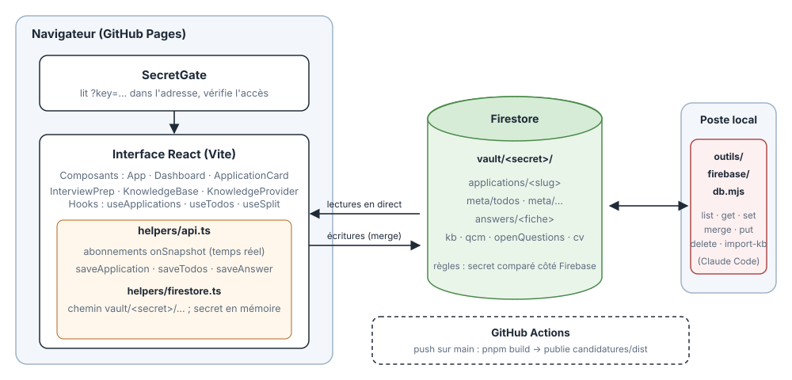

# Suivi de candidatures

Site : https://mathieujullien77190.github.io/job/

La page lit ses données dans Firestore et demande un secret dans l'adresse (`?key=…`). Sans lui, elle affiche une erreur.

## Architecture

La page (Vite + React, dans `candidatures/`) n'a pas de serveur : elle lit et écrit directement Firestore, sous `vault/<secret>/`, en temps réel. Le secret vient de l'adresse (`?key=…`). Les mêmes données sont accessibles en local par `outils/firebase/db.mjs`, et GitHub Actions publie le build sur Pages à chaque push sur `main`.
